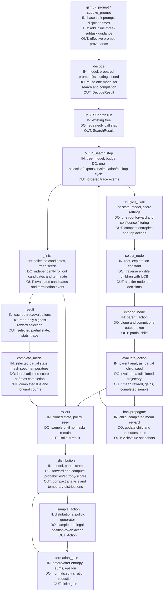

# MEDAL reconstruction walkthrough

The shared implementation is [mcts_decoding.py](../src/dlm_project/decoding/mcts_decoding.py). All existing MCTS callers now use full sampled rollouts. The reference is [MEDAL, Algorithms 1–2 and Sections 3.1–3.3](https://aclanthology.org/2026.findings-eacl.180.pdf). This is a documented paper reconstruction, version `medal_reconstruction_v1`; author-code parity is unverified.

## Definitions and reconstruction choices

A tree state contains fixed prompt tokens and partially filled output positions. Each action is `(output_position, token_id)`. Positions are relative to the output. The mask token cannot be committed. Independent CPU clones prevent simulations from completing the tree nodes themselves.

Compute full-vocabulary probabilities, `H = -sum(p * log(p + epsilon))`, the top-two probability gap, and `s = p * exp(-H) * sigmoid(gamma * gap)`. Keep K1 tokens per position and K2 actions globally. UCB uses mean completed-simulation reward plus `c * sqrt(log(parent_visits) / child_visits)`; unvisited nodes rank first. Ties use adjusted score, position, token ID, then node ID.

Simulation selects the globally highest adjusted-confidence position and samples its token from the full legal model probabilities at temperature 1. It repeats until every mask is removed. This position policy is a reconstruction assumption. Simulation sampling is not restricted to the tree's K1/K2 vocabulary.

The paper does not fully specify trajectory reward aggregation. This implementation computes `g = (S_before - S_after) / S_before` for each transition and returns the arithmetic mean. S sums predictive entropy over currently masked output positions. A denominator at or below epsilon gives zero gain; finite negative gains remain unchanged. A terminal state has no remaining entropy and needs no terminal forward. Expanded-node simulation includes its forced parent-to-child transition. Backpropagation occurs once per completed simulation, not once per transition.

Collect the first C distinct depth-Lc states, stopping immediately at the quota. Each receives a fresh independently seeded full rollout; its mean gain determines ranking. Ties choose the earliest collected candidate. Candidate evaluation does not update tree visits. The winner remains a partial state, and final completion samples fresh actions using literal `softmax(s / temperature)` across all legal masked position-token pairs. It does not use `softmax(log(s))`, top-K filtering, a cached first commitment, or the candidate's completed sample. This softmax is relatively flat at temperature 1; matching the pseudocode does not establish the authors' runtime behavior or accuracy.

Inline prompting uses three subtasks and two disjoint demonstrations. GSM8K demonstrations are training rows 0/1 pinned to the test manifest revision. The paper's illustrated demonstrations overlap test rows 0/1, so they are deliberately not copied. Sudoku uses synthetic examples. No evaluated reference, answer parser, or Sudoku validator supplies rewards. Decomposition generates within the answer sequence and adds no separate planning forwards.

The sampler and aggregation choices above are exported in `RECONSTRUCTION_ASSUMPTIONS`. Gamma 10 and exploration constant 0.01 are repository defaults, not verified author settings. The mean-stepwise reward is not claimed to reproduce the appendix's surrogate-objective theorem.

## Function flowchart

Each box is a function, listing its inputs, responsibility, and output. Arrows represent calls or the next function in the orchestration.



## Forward accounting and stopping

Defaults: L=256, Lc=20, C=3, K1=3, K2=5, epsilon=1e-8, seed=1, temperature=1; steps and block length equal L. The search cap is `None`. Strict candidate mode must satisfy the candidate and evaluation quotas; frontier exhaustion or a finite cap produces `SearchIncompleteError`, retaining flushed traces and earlier predictions.

Search forwards = tree-analysis forwards + all branch-simulation forwards + candidate-evaluation forwards. Total = search + fresh final-completion forwards. Each completed branch at depth d uses L-d forwards. Interrupted calls also consume the cap, but incomplete rewards never reach backpropagation. Three default candidate evaluations cost 708 forwards and final completion costs 236. A direct-path example with 19 five-child expansion cycles and three final children costs `1 + 5*sum(256-d for d in range(1,20)) + 3*236 + 3*236 + 236 = 25,023`; broader exploration costs more.

For a controlled four-position example, Lc=2, C=3, K1=K2=2 and static tied position scores: six children cost 14 simulation forwards, root analysis costs 1, candidate evaluations cost 6, and final completion costs 2: 23 total. The root has six visits, not 22.

Explicit `stop_mode: budget` requires a positive finite cap and is a budget-limited ablation. At exhaustion it selects the deepest state with a completed simulation, or root if none exists. Unfinished branch rewards are discarded. Candidate evaluation shares that cap; final completion is additional. Existing 128/256/512 sweep caps can complete very few branch simulations and do not promise depth 20.

## APIs and artifacts

`MCTSSearch(..., seed=1, on_event=...)` exposes resumable `step()`, `run()`, and inference-free `result()`. `mcts_confidence.decode(...)` keeps the historical method identifier and returns `DecodeResult`. Prompt augmentation belongs to task runners, before chat tokenization; low-level callers must pass prepared prompt IDs. `complete_confidence()` remains the standalone greedy baseline helper and is no longer MCTS completion.

```bash
python scripts/eval_gsm8k_mcts_confidence.py --profile smoke --num-samples 2
python scripts/inspect_mcts.py --phase one_step --trace-path results/inspection.jsonl
python scripts/run_gsm8k_sweep.py --profile smoke --num-samples 2 --budgets 128 256 512
```

New labels include `medal-v1`; traces and predictions record implementation version, assumptions, phase costs, seeds, candidate outputs/rewards, selected initialization, and base/effective prompt hashes. Historical artifacts are retained and older report schemas remain readable. Final-answer scoring happens only after generation. CPU tests establish mechanics; real model accuracy requires CUDA benchmark runs.
