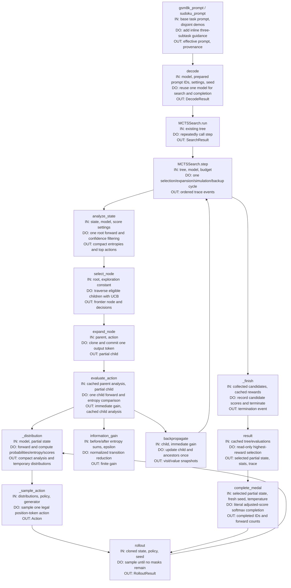

# MEDAL reconstruction walkthrough

The shared implementation is [mcts_decoding.py](../src/dlm_project/decoding/mcts_decoding.py). All MCTS callers evaluate the immediate parent-to-child entropy change. The reference is [MEDAL, Algorithms 1–2 and Sections 3.1–3.3](https://aclanthology.org/2026.findings-eacl.180.pdf). This is a documented paper reconstruction, version `medal_reconstruction_v2`; author-code parity is unverified. Version 1 used full sampled search and candidate rollouts; version 2 removes them.

## Definitions and reconstruction choices

A tree state contains fixed prompt tokens and partially filled output positions. Each action is `(output_position, token_id)`. Positions are relative to the output. The mask token cannot be committed. Expansion clones the parent's CPU state and fixes exactly one output token; evaluation leaves that partial state unchanged.

Compute full-vocabulary probabilities, `H = -sum(p * log(p + epsilon))`, the top-two probability gap, and `s = p * exp(-H) * sigmoid(gamma * gap)`. Keep K1 tokens per position and K2 actions globally. UCB uses mean completed-simulation reward plus `c * sqrt(log(parent_visits) / child_visits)`; unvisited nodes rank first. Ties use adjusted score, position, token ID, then node ID.

Simulation performs one forward on the immediate child and caches its masked-position entropies and top actions. The parent analysis is already cached. It generates no additional tokens and performs no completion rollout.

The reward is `g = (S_parent - S_child) / S_parent`, using only the expansion's immediate transition. S sums predictive entropy over currently masked output positions. A denominator at or below epsilon gives zero gain; finite negative gains remain unchanged. Backpropagation updates the child and its ancestors once per evaluated child. UCB averages these backed-up edge rewards.

Collect the first C distinct depth-Lc states, stopping immediately at the quota. Rank them using cached mean tree rewards, with ties choosing the earliest collected candidate. These leaves are each evaluated once, so their mean reward equals their immediate parent-to-child gain. Candidate ranking adds no forwards or visits. The winner remains a partial state, and final completion samples fresh actions using literal `softmax(s / temperature)` across all legal masked position-token pairs. This is the only phase that fills all remaining masks. Completion uses no top-K filtering and starts with a fresh forward.

Inline prompting uses three subtasks and two disjoint demonstrations. GSM8K demonstrations are training rows 0/1 pinned to the test manifest revision. The paper's illustrated demonstrations overlap test rows 0/1, so they are deliberately not copied. Sudoku uses synthetic examples. No evaluated reference, answer parser, or Sudoku validator supplies rewards. Decomposition generates within the answer sequence and adds no separate planning forwards.

The reward, candidate ranking, and completion choices above are exported in `RECONSTRUCTION_ASSUMPTIONS`. Gamma 10 and exploration constant 0.01 are repository defaults, not verified author settings.

## Function flowchart

Each box is a function, listing its inputs, responsibility, and output. Arrows represent calls or the next function in the orchestration.



## Forward accounting and stopping

Defaults: L=256, Lc=20, C=3, K1=3, K2=5, epsilon=1e-8, seed=1, temperature=1; steps and block length equal L. The search cap is `None`. Strict candidate mode must collect C distinct evaluated candidates; frontier exhaustion or a cap reached before the quota produces `SearchIncompleteError`, retaining flushed traces and earlier predictions.

Search forwards = one root-analysis forward + one forward per evaluated child. Candidate ranking costs zero forwards. Total = search + fresh final completion, which costs L minus selected depth. A direct-path example with 19 five-child expansion cycles and three final children costs `1 + 19*5 + 3 + 236 = 335` forwards; broader exploration can cost more.

For a controlled four-position example, Lc=2, C=3, K1=K2=2 and static tied position scores: six children cost six simulation forwards, root analysis costs one, candidate ranking costs zero, and final completion costs two: nine total. The root has six visits.

Explicit `stop_mode: budget` requires a positive finite model-call or simulation cap. It ranks any collected depth-Lc candidates by their cached rewards; otherwise it selects the deepest evaluated state, breaking ties by mean tree reward and node ID, or root if none exists. Unfinished child evaluations never update visits. Final completion is additional. A model-call cap B allows up to B-1 child evaluations; a simulation cap N allows N child evaluations plus the root forward. Neither guarantees depth 20.

## APIs and artifacts

`MCTSSearch(..., seed=1, on_event=...)` exposes resumable `step()`, `run()`, and inference-free `result()`. `mcts_confidence.decode(...)` keeps the historical method identifier and returns `DecodeResult`. Prompt augmentation belongs to task runners, before chat tokenization; low-level callers must pass prepared prompt IDs. `complete_confidence()` remains the standalone greedy baseline helper and is no longer MCTS completion.

```bash
python scripts/eval_gsm8k_mcts_confidence.py --profile smoke --num-samples 2
python scripts/inspect_mcts.py --phase one_step --trace-path results/inspection.jsonl
python scripts/run_gsm8k_sweep.py --profile smoke --num-samples 2 --budgets 128 256 512
```

New labels include `medal-v2`; traces and predictions record implementation version, assumptions, phase costs, completion seed, candidate partial states/rewards, selected initialization, and base/effective prompt hashes. `candidate_evaluation_model_calls` remains available with value zero, and `simulation_decoding_steps` is zero because search has no internal rollouts. Historical artifacts are retained and older report schemas remain readable. Final-answer scoring happens only after generation. CPU tests establish mechanics; real model accuracy requires CUDA benchmark runs.
